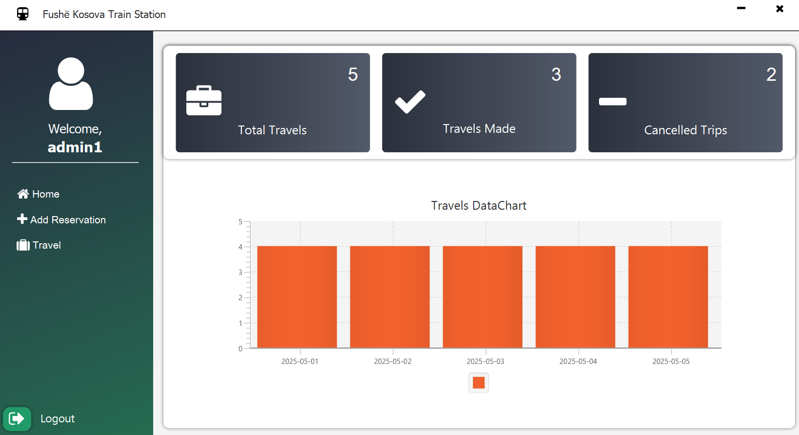
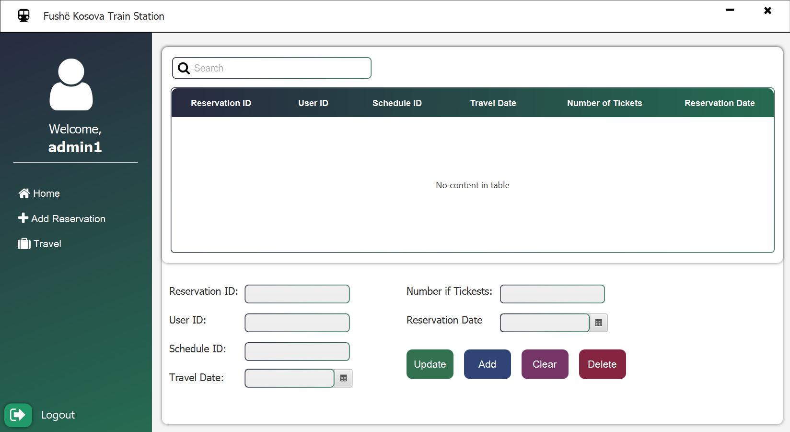

# Train Management System

A JavaFX desktop application for managing train schedules and passenger reservations. The project demonstrates how a modular Java application connects FXML views, business services, and JDBC repositories to a PostgreSQL database.

## Features

- Register an application account and sign in using accounts stored in PostgreSQL.
- List, search, add, update, and delete reservations from the dashboard.
- List, add, and delete line schedules. The schedule update action changes the day of service.
- View total, completed, and canceled trip counts and a chart of trips grouped by date.

## Technology Stack

| Technology | Use |
| --- | --- |
| Java 23 and JPMS | Application code and module configuration |
| JavaFX 17.0.6, FXML, and CSS | Desktop windows, forms, tables, charts, and styling |
| PostgreSQL and pgJDBC 42.7.5 | Relational storage and database access through JDBC |
| Maven and JavaFX Maven Plugin 0.0.8 | Dependency management, compilation, and application launch |
| FontAwesomeFX 4.7.0-9.1.2 | Icons, with FontAwesomeFX Commons supplied transitively |
| JUnit Jupiter 5.10.2 | Declared test dependencies |

## Project Structure

| Path | Responsibility |
| --- | --- |
| `pom.xml` | Maven dependencies, Java 23 compiler target, and JavaFX launcher |
| `src/main/java/com/example/knk_2025/` | JavaFX entry point and sample view controller |
| `src/main/java/Controllers/` | Login, signup, and dashboard controllers |
| `src/main/java/Services/` | Authentication, session state, and business operations |
| `src/main/java/Repository/` | JDBC queries and persistence |
| `src/main/java/Database/` | PostgreSQL connection configuration |
| `src/main/java/models/` and `src/main/java/models/Dto/` | Domain models and data transfer objects |
| `src/main/java/Package01/Main.java` | Optional sample data seeder for an existing schema |
| `src/main/java/module-info.java` | Java module dependencies and FXML access |
| `src/main/resources/com/example/knk_2025/` | FXML views and CSS |

## Database Setup

1. Run PostgreSQL on `localhost:5432`.
2. Restore the original project database or provision its compatible schema in a database named `knk_project`. The application connects to `jdbc:postgresql://localhost:5432/knk_project`.
3. Ensure the PostgreSQL role configured in [DBConnector.java](src/main/java/Database/DBConnector.java) can connect and access the project tables. The application's login form uses a separate account stored in `perdoruesit`.
4. Set `DB_PASSWORD` to the password for the PostgreSQL role before starting the application.

Login expects `perdoruesit` with the columns `perdorues_id`, `emri_perdoruesit`, `fjalekalimi`, and `roli`. The dashboard also queries `rezervime`, `orari_linjave`, and trip data. Restore the full schema so referenced tables, defaults, and constraints are available.

The repository has no schema DDL, migrations, or database dump. `Package01.Main` inserts sample rows into existing tables. Avoid running it against a restored database or one containing real records.

## Run in IntelliJ IDEA

1. Install a JDK 23 distribution. In IntelliJ IDEA, open `pom.xml` as a project and let Maven sync.
2. Set the **Project SDK** to JDK 23 in **File → Project Structure**. In **Settings → Build, Execution, Deployment → Build Tools → Maven**, select bundled Maven or a local Maven installation.
3. In **Run → Edit Configurations**, add a **Maven** configuration. Select the project root as the working directory, set the goal to `javafx:run`, and select JDK 23 as the runner JRE.
4. In that configuration's **Environment variables** field, add `DB_PASSWORD` and enter your PostgreSQL password locally. Leave **Store as project file** unchecked and keep local run settings containing secrets out of Git.
5. Run the Maven configuration. At the JavaFX login window, use an application account from the restored database or create one through **Sign up**.

See the [IntelliJ Maven setup guide](https://www.jetbrains.com/help/idea/maven-support.html) and [Maven run configuration reference](https://www.jetbrains.com/help/idea/run-debug-configuration-maven.html) for the IDE controls.

### Set `DB_PASSWORD` for a Single Launch

If Maven is on your `PATH`, the IntelliJ terminal can launch the app without storing the password in an IDE run configuration. From the project root in PowerShell:

```powershell
$env:DB_PASSWORD = [System.Net.NetworkCredential]::new('', (Read-Host 'PostgreSQL password' -AsSecureString)).Password
try {
    mvn javafx:run
} finally {
    Remove-Item -LiteralPath Env:DB_PASSWORD -ErrorAction SilentlyContinue
}
```

The prompt masks input and the application inherits the variable from Maven. Keep passwords out of source code, shared configurations, and screenshots.

## Screenshots
## Screenshots

### Login


### Dashboard


## Known Limitations

- The application requires a separately provisioned PostgreSQL schema and a running database.
- The trip repository uses `udhetimet`, while the dashboard chart queries `udhetime`. A schema with only one of these names can leave part of the trip dashboard unavailable.
- Application account passwords are compared directly with stored values. Use this project with local demo data and avoid using real or reused passwords.
- The Maven Wrapper scripts are present, but their `.mvn/wrapper` configuration is absent. Use bundled or installed Maven.
- JUnit dependencies are declared, but this checkout contains no automated test sources.
